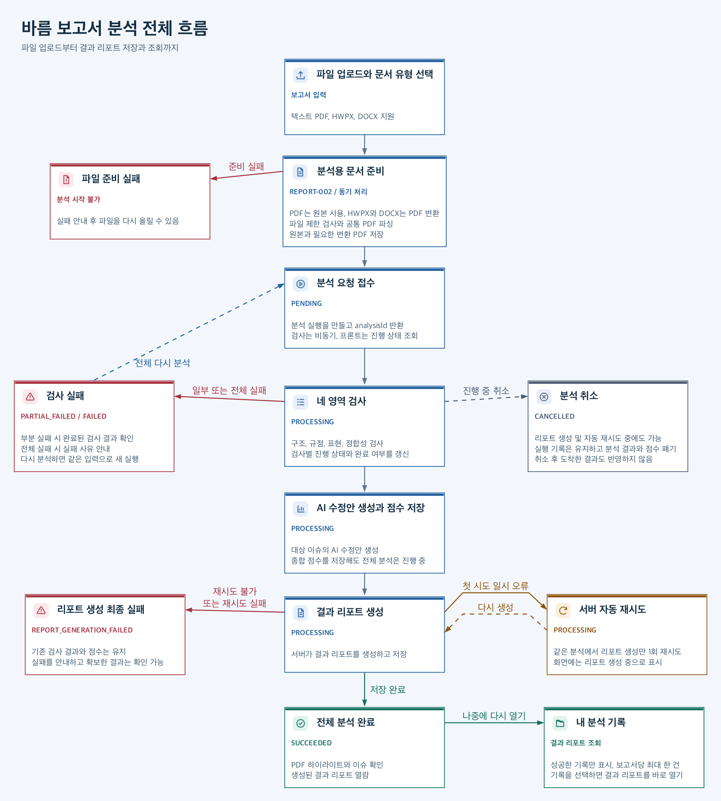

# 보고서 분석 흐름

바름 MVP에서 보고서 파일을 업로드한 뒤 결과 리포트를 확인하기까지의 흐름을 정리한다.

## 분석 상태와 재시도

- PDF 준비와 본문 파싱을 마친 뒤 분석을 시작한다. 점수를 저장해도 전체 상태는 `PROCESSING`으로 유지하며, 결과 리포트까지 저장되면 `SUCCEEDED`로 전환한다.
- 검사 실패 후 사용자가 다시 분석하면 같은 입력으로 새 분석을 시작한다. 리포트 생성 중 첫 시도에 일시적인 오류가 발생하면 서버가 기존 분석에서 리포트 생성 단계만 한 번 재시도한다.
- 리포트 생성이 최종 실패하면 `REPORT_GENERATION_FAILED`로 기록하고 검사 결과와 점수를 유지한다. 분석을 취소하면 실행 기록을 유지하고 결과와 점수를 폐기한다.
- ‘내 분석 기록’에는 리포트 생성까지 성공한 기록을 보고서당 최대 한 건 표시한다. 기록을 선택하면 결과 리포트가 열린다.
